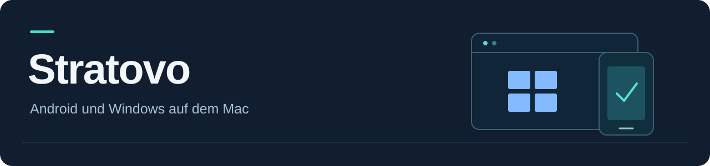

# Stratovo · 1.0 Beta 1

[Beta-Anleitung und Speicherbedarf pro VM](docs/RELEASE_1.0_BETA1.md)

## Android-Emulator und Windows-ARM64-VM für Mac

[English](README.md)

<p align="center">
  
</p>

**Ein nativer macOS-Player für Android ARM64 und Windows ARM64. Open Source, kostenlos und ohne Abo.**

Entwickelt von **[PwnedG0blin](https://github.com/PwnedG0blin)** · **1.0 Beta 1** · macOS **14+** · **Apple Silicon** · [MIT-Lizenz](LICENSE)

Stratovo verbindet zwei getrennte Gastsysteme mit einer gemeinsamen Mac-Oberfläche. Android und Windows öffnen jeweils ein eigenes, frei skalierbares Playerfenster. Apps, Konten und virtuelle Datenträger bleiben zwischen den Sitzungen gespeichert. Beim Öffnen der App wird kein Gast automatisch gestartet.

**Stratovo hieß bisher Pixelkoje.** Das Repository behält seine bisherige Adresse `OpenGuest`. Bundle-ID, Einstellungen, Gastsysteme und Datenpfade bleiben für bestehende Installationen kompatibel.

[Einrichtung](LIES_MICH_ZUERST.md) · [Test-Builds](https://github.com/PwnedG0blin/OpenGuest/actions/workflows/macos.yml) · [Fehler melden](https://github.com/PwnedG0blin/OpenGuest/issues/new/choose) · [Mitwirken](CONTRIBUTING.md)

## Sprache

Beim Start wird die bevorzugte macOS-Sprache automatisch übernommen. Unter **Einrichtung → Sprache** lässt sich das ändern. Enthalten sind 14 Sprachordner (siehe Beta-Anleitung). Zentrale Bedienelemente sind übersetzt; noch fehlende technische Übersetzungen verwenden Englisch. Einige Werkzeugmeldungen und Protokolle bleiben im Original. Android und Windows behalten ihre eigene Sprache.

## Funktionen

| Bereich | Aktueller Funktionsumfang |
| :--- | :--- |
| **Android** | Android 16 mit Google Play als Standard; Android 17 optional als eigenes Profil. Neue Profile mit 64 GiB, APK-Installation und Google-Anmeldung im Gast. |
| **Windows** | Dauerhaft gespeicherte ARM64-VM, manuelle ISO-Auswahl als Installations-DVD, Treiber-CD und vergrößerbarer virtueller Datenträger. |
| **Player** | Getrennte Fenster, Bild einpassen, Zoom sowie einstellbare Android-Auflösung und Dichte. Windows-Anzeigemodi hängen vom installierten Gasttreiber ab. |
| **Eingabe** | Text vom Mac in Android oder Windows übertragen; getrennt einstellbares Scrolltempo und Trackpad-Nachlauf. Android bietet zusätzlich Touch-Wischen mit zwei Fingern. |
| **Speicher** | Datenordner beim ersten Start wählen, auch auf einer externen SSD. Geführte Übernahme bestehender Standardordner mit Inhaltsprüfung. |
| **Diagnose** | Gemeinsames Protokoll für Android, Windows und Einrichtung; Status für Renderer, Bildübertragung und Startvorgang. |

Google-Synchronisierung und Cloud-Spielstände hängen von der jeweiligen App und dem offiziellen Systemabbild ab. Die Anmeldung im Mac-Browser meldet den Android-Gast nicht automatisch an.

## Installation und Einrichtung

1. **App beziehen:** Die DMG unter [GitHub Releases](https://github.com/PwnedG0blin/OpenGuest/releases) herunterladen und Stratovo.app in Programme kopieren. Alternativ auf einem Mac [aus dem Quellcode bauen](#aus-dem-quellcode-bauen).
2. **Datenordner wählen:** Beim ersten Start den gewünschten Speicherort festlegen. Für eine externe SSD empfiehlt sich ein eigener Projektordner; eine bestehende Installation kann ihren bisherigen Pfad weiterverwenden.
3. **Komponenten einrichten:** Im **Dashboard** und unter **Einrichtung** Android-Werkzeuge, Systemabbild und Videostream vorbereiten. Für Windows werden QEMU, TPM-Unterstützung, geeignete ARM64-UEFI-Firmware und eine Windows-ARM64-ISO benötigt.
4. **System prüfen und starten:** Den gewünschten Gast auswählen und ausdrücklich starten. Beim ersten Windows-Start die Installation im Gast durchführen.

Die [Schritt-für-Schritt-Anleitung](LIES_MICH_ZUERST.md) beschreibt Android, Windows, Treiber, Updates und den Umzug auf eine externe SSD.

## Updates über GitHub

Im **Dashboard** oder unter **Updates** prüft Stratovo öffentliche [GitHub Releases](https://github.com/PwnedG0blin/OpenGuest/releases) und zeigt die Versionshinweise an.

- Manuelle Prüfung per Klick; automatische tägliche Prüfung ist standardmäßig aus.
- Vorabversionen sind standardmäßig eingeschlossen und lassen sich ausschließen.
- Ein angebotenes Apple-Silicon-App-Paket wird erst nach Bestätigung geladen und installiert. Zuvor müssen alle Gäste und der Grafikbau beendet sein.
- Repository, Version, SHA-256, Paketgröße, Bundle-ID und Codesignatur werden geprüft. Die bisherige App bleibt als Rückkehrkopie erhalten; die VM-Daten werden nicht ersetzt.
- Beim Abruf entstehen technisch notwendige Netzwerkdaten bei GitHub. Stratovo übermittelt keine Diagnoseprotokolle. Es gelten [GitHubs Datenschutzbestimmungen](https://docs.github.com/en/site-policy/privacy-policies/github-general-privacy-statement).

## Entwicklungsstand

Stratovo ist eine **öffentliche Testversion**. Die Mac-App, Protokolle und Eingabewege werden automatisiert geprüft; vollständige Installationen, Spielekompatibilität und dauerhaft stabile Bildraten müssen zusätzlich auf echten Zielsystemen getestet werden.

- **Android-Grafik:** Mac-GPU-Modus mit optionalem OpenGL-ES-Kompatibilitätstest durch Abschalten von Vulkan. Der Emulator kann weiterhin Software-Rendering erzwingen. Ein 60-FPS-Ziel ist keine Garantie für 60 Spielbilder pro Sekunde.
- **Windows-Grafik:** Basisgrafik oder optionale Virtio-GPU nach Installation passender ARM64-Treiber. Zusätzlich gibt es ein experimentelles VirtIO-/Neptune-/DXMT-Grafiklabor mit eigener Windows-Testkopie. Voraussetzungen und Speicherbedarf stehen in der [Beta-Anleitung](docs/RELEASE_1.0_BETA1.md).
- **Gastsysteme:** Aktuell läuft jeweils ein Gast. Ein Wechsel erfordert das Herunterfahren des bisherigen Systems.
- **Verteilung:** Die Test-App ist ad-hoc signiert, nicht mit Apple Developer ID signiert oder notarisiert. Hinweise zum Start und zur geplanten Signierung stehen in [SIGNIERUNG.md](SIGNIERUNG.md).
- **Abhängigkeiten:** Emulator, Engines, Treiber und Betriebssystemabbilder werden separat eingerichtet. Windows benötigt eine passende eigene Lizenz; Fremdkomponenten behalten ihre Lizenzbedingungen.

Die Android- und Windows-Daten werden bei einer normalen Sitzung weiterverwendet. Vor Aktualisierungen beide Gäste regulär herunterfahren und die App schließen. Hinweise zu Zugriffsgrenzen, temporären Einrichtungsmedien und Berichten stehen in [SECURITY.md](SECURITY.md).

## Aus dem Quellcode bauen

Auf einem Apple-Silicon-Mac mit passenden Xcode-Werkzeugen im Projektordner:

```bash
/bin/bash scripts/build-app.sh
```

Das Skript führt Tests aus und erstellt `dist/Stratovo.app`. `Start.command` baut und öffnet die lokale App. Der CI-Workflow ergänzt Paket- und Startprüfungen auf macOS; er ersetzt keinen vollständigen Gasttest.

Technischer Aufbau: SwiftUI und AppKit für die Oberfläche, Android Emulator und scrcpy für Android, QEMU mit Hypervisor.framework sowie lokaler RFB-Bildübertragung für Windows. Weitere Angaben: [Drittanbieter](THIRD_PARTY_NOTICES.md) · [Testplan](docs/TESTPLAN.md).

## Mitwirken

Fehlerberichte, Dokumentationsverbesserungen und nachvollziehbare Pull Requests sind willkommen. Bitte zuerst [CONTRIBUTING.md](CONTRIBUTING.md) lesen. Bei Fehlern helfen die App-Version, macOS-Version, das betroffene Gastsystem und ein bereinigter Diagnoseauszug.

Bisherige Versionshinweise und frühere Anleitungen bleiben im [Versionsarchiv](docs/CHANGELOG_ARCHIVE.md) und [Anleitungsarchiv](docs/ANLEITUNGEN_ARCHIV.md) erhalten. Diese Archive beschreiben historische Stände.

## Entwickler und Unterstützung

**PwnedG0blin** · [GitHub](https://github.com/PwnedG0blin) · [X](https://x.com/PwnedG0blin) · [Patreon](https://www.patreon.com/cw/PwnedG0blinApp)

Copyright (c) 2026 PwnedG0blin. Quellcode unter der [MIT-Lizenz](LICENSE); [Entwickler- und Beitragshinweise](AUTHORS.md). Unterstützungsangebote sind freiwillig; Stratovo bleibt kostenlos und ohne Abo.
